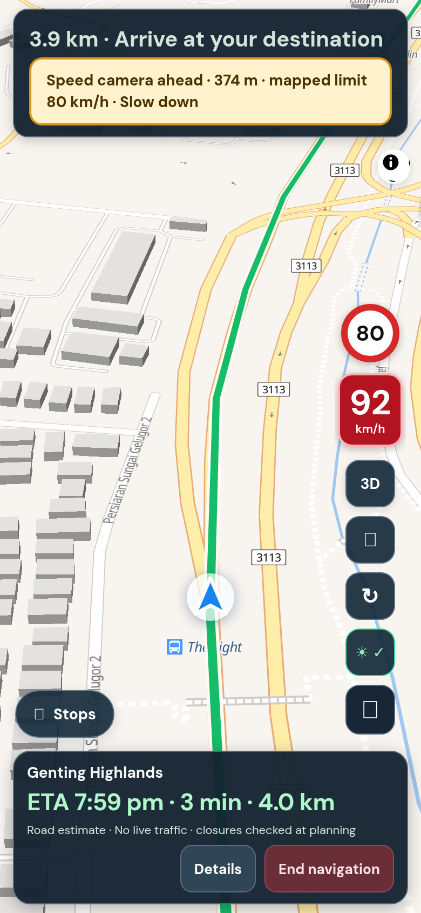

## Purpose

Drivers asked for what Waze has: the speed limit on screen and a warning when you go over it. TuJu users also complained about having no speed limit warnings.

## Changes (what you will notice)

While driving you now see:

- A round **speed limit sign** above your speed. It only appears where the road's limit is known.
- Your **speed turns amber** a little over the limit, and **red** well over it.
- A **spoken warning** ("Slow down. Speed limit 80.") after about 4 seconds of continued speeding, at most once every 45 seconds.
- A **heads-up before the limit drops** ("Speed limit drops to 80 in 400 metres").
- Speed-camera alerts now mention the road's limit when the camera has none of its own.
- A switch to turn all of this off under Menu, More options, Map details.

The limits come from OpenStreetMap, not guesses. Where a road has no mapped limit, Lapan shows nothing. I measured how much is mapped by road length: expressways 83.5%, trunk roads 41.9%, primary roads 27.6%, secondary roads 14.5% and tertiary roads 7.3%. Local streets are left out because under 3% of them have a limit, so a sign there would flicker on and off.

## Testing

**Screenshots**


*Left side of the screen: the sign shows 80, the speed chip is red at 92, and a camera alert names the limit.*

**Try it yourself, by hand**

Driving is needed to see this for real. The easy ways:

1. **Without driving:** I tested with a recorded drive along a real Penang road, replayed into the app. That replay tool is not part of this PR (the screenshot above comes from it); I can offer it as a separate small PR if you would find it useful.
2. **On a real drive** along an expressway: the sign should match the real road sign. If it shows nothing, that stretch is not mapped, which is expected.
3. Turn the switch off in Map details. Expected: the sign and warnings disappear.
4. Open Menu, More options, Map details. Expected: a note says limits are from OpenStreetMap and incomplete.

**Run the automated checks** (about 10 seconds, no accounts or keys needed)

```sh
git remote add dandycrypto https://github.com/dandycrypto/lapan-malaysia.git   # first time only
git fetch dandycrypto pr/02-speed-limits
git switch --detach FETCH_HEAD
npm run build && npm test
```

Expected: the last line reads `29 of 29 test files passed`. Result when I ran it on commit `9ca693d`: **29 of 29 test files passed**.

A combined copy of the whole series (every PR together, not this PR alone) runs at https://lapan-test.dysolvit.com if you would rather look at it on a phone. It may be a little behind the latest commits.

**What I have not tested**

- Not checked against real road signs outside the Penang road used in the replay.
- Not tested on a real iPhone (Safari) or a real Android phone. Everything was checked in desktop Chrome sized like a phone (390 x 844).
- Not tested with real GPS while driving. A recorded drive along a real road was replayed instead.
- Not tested against live TomTom. The route in the replay is a fixed copy, so real routing, traffic and tolls were not exercised.
- Not load tested.

## Dependencies

None needed to merge. It is built on the earlier PRs in the series (the test runner and the security headers).

## Impact

- **No new outside services or costs.** The data ships with Lapan as a file (2.4 MB, 0.78 MB compressed). Phones download it only when someone presses Start Navigation. It adds about 0.78 MB (compressed) to the app package.
- No new permissions or settings. The data is OpenStreetMap, free to use with credit; the credit is shown in the app and README.
- **Limits:** coverage is incomplete (numbers above); mapped limits can be wrong or out of date; GPS speed has a small margin of error, so the first warning allows 3 km/h. The warnings never replace road signs.
- Refreshing the data is a manual step (`scripts/extract-speed-limits.py`, documented in the README).

---
Built with AI assistance (Claude Code). The tests above were run on the commit shown. Part of a 10 PR series; merge in order with rebase, and each later PR shrinks as the earlier ones land. `UNRELEASED.md` will conflict between PRs because each adds one bullet; keep both. Per `AGENTS.md`, nothing here bumps the version or edits the changelog.

🤖 Generated with [Claude Code](https://claude.com/claude-code)
