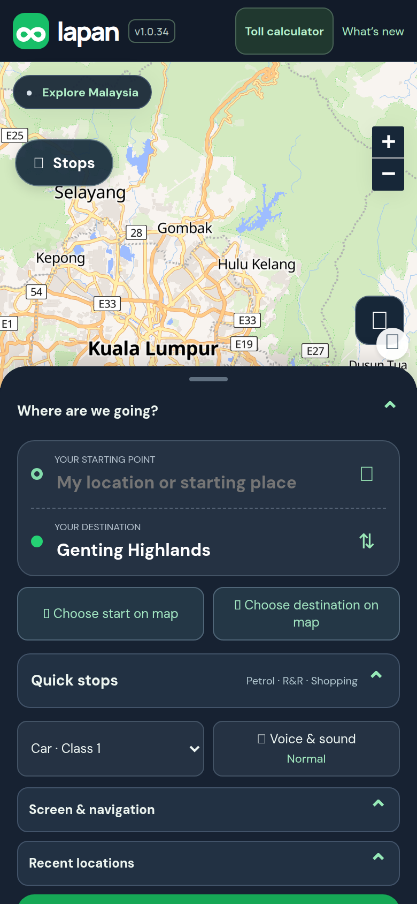
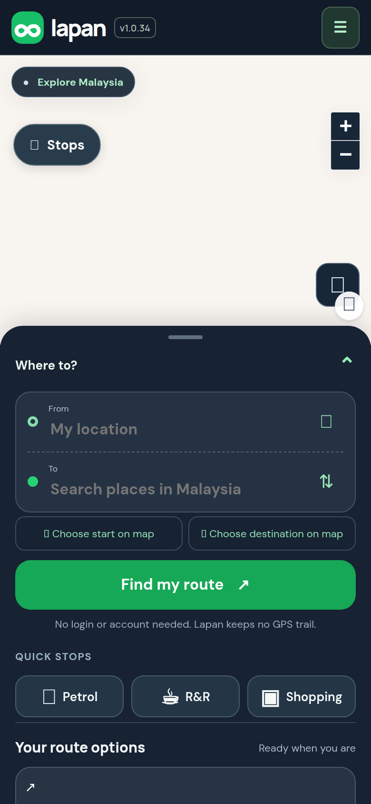
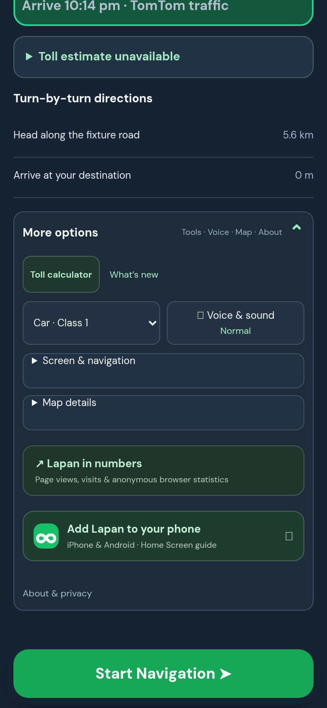

## Purpose

The goal is to keep Lapan simple and light. The first screen had about 19 things to tap, and the main button (Find my route) sat at the very bottom edge, so a new person had to scroll to find it. The destination was also pre-filled with "Genting Highlands", which looks like a mistake to someone new. TuJu's reviews and Waze's design both point the other way: one clear task up front.

## Changes (what you will notice)

Same features, calmer layout:

- The top bar is now the logo, the version badge and one **Menu** button.
- **Find my route** sits right under the From and To boxes.
- **No pre-filled destination.** The To box is empty until you choose a place.
- A one-line promise: "No login or account needed. Lapan keeps no GPS trail."
- **Recent places** show right there once you have some (three at most). Quick stops (Petrol, R&R, Shopping) are one slim row.
- Everything else moved under **Menu, More options**: Toll calculator, What's new, vehicle, voice, screen and map options, the install guide and About & privacy. Nothing was removed and the version badge is still there, as `AGENTS.md` requires.

## Testing

**Screenshots**




*Before (live site today), after, and the Menu opened.*

**Try it yourself, by hand**

On a phone:

1. Open the app. Expected: it looks like the "after" picture above, with Find my route visible without scrolling.
2. Tap **Find my route** with the To box empty. Expected: a message asks you to enter a destination.
3. Type `KL Sentral`, tap Find my route. Expected: routes appear as before.
4. Tap the **Menu** button (top right). Expected: More options opens and shows the Toll calculator and the other tools.
5. Tap Toll calculator. Expected: it opens as before.

**Run the automated checks** (about 10 seconds, no accounts or keys needed)

```sh
git remote add dandycrypto https://github.com/dandycrypto/lapan-malaysia.git   # first time only
git fetch dandycrypto pr/03-planner-declutter
git switch --detach FETCH_HEAD
npm run build && npm test
```

Expected: the last line reads `30 of 30 test files passed`. Result when I ran it on commit `49bad27`: **30 of 30 test files passed**.

A combined copy of the whole series (every PR together, not this PR alone) runs at https://lapan-test.dysolvit.com if you would rather look at it on a phone. It may be a little behind the latest commits.

**What I have not tested**

- Not tested on desktop-width screens; I only checked phone width.
- Not tested on a real iPhone (Safari) or a real Android phone. Everything was checked in desktop Chrome sized like a phone (390 x 844).
- Not tested with real GPS while driving. A recorded drive along a real road was replayed instead.
- Not tested against live TomTom. The route in the replay is a fixed copy, so real routing, traffic and tolls were not exercised.
- Not load tested.

## Dependencies

None needed to merge. The series order is only for tidy merging.

## Impact

- No new services, API calls, costs, permissions or settings. Every button keeps its name, so existing behaviour is unchanged.
- **One visible behaviour change:** returning users no longer see their last destination pre-filled. It now shows under Recent places.
- I added a test that fails if any element the app's scripts look up goes missing, or if two elements share a name. That is the main risk when moving things around.

---
Built with AI assistance (Claude Code). The tests above were run on the commit shown. Part of a 10 PR series; merge in order with rebase, and each later PR shrinks as the earlier ones land. `UNRELEASED.md` will conflict between PRs because each adds one bullet; keep both. Per `AGENTS.md`, nothing here bumps the version or edits the changelog.

🤖 Generated with [Claude Code](https://claude.com/claude-code)
