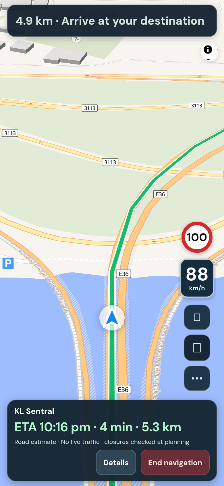
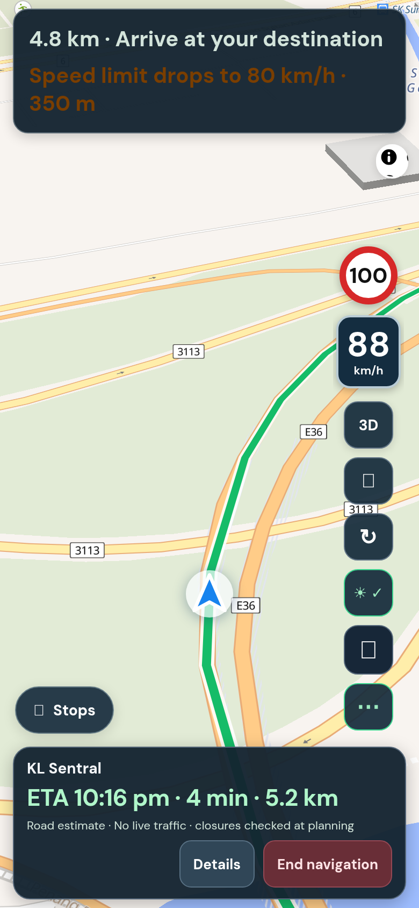

## Purpose

While navigating, the screen showed five round buttons, a Stops button, the speed, the limit sign and up to two warning banners all at once. Drivers should see only what they need.

## Changes (what you will notice)

- Always visible: the turn and distance bar, the ETA bar, your speed with the limit sign, voice, re-centre, and a new **⋯ More** button.
- Tap **⋯** to show the rest: 3D/2D, repeat the last instruction, keep-screen-awake, and Stops. They hide again when you end navigation.
- If a speed-camera alert and a limit-drop notice are both due, only the camera alert shows.

## Testing

**Screenshots**



*Left: default. Right: after tapping ⋯. Compare with the crowded "before" in the speed-limit PR.*

**Try it yourself, by hand**

Needs a real drive (or a replayed one, as described in the speed-limit PR):

1. Start navigation. Expected: the calm screen shown above.
2. Tap **⋯**. Expected: the extra buttons appear and the ⋯ button turns green.
3. Tap Voice. Expected: the voice settings open, as before.
4. End navigation and start again. Expected: the extra buttons are hidden again.

**Run the automated checks** (about 10 seconds, no accounts or keys needed)

```sh
git remote add dandycrypto https://github.com/dandycrypto/lapan-malaysia.git   # first time only
git fetch dandycrypto pr/04-driving-declutter
git switch --detach FETCH_HEAD
npm run build && npm test
```

Expected: the last line reads `31 of 31 test files passed`. Result when I ran it on commit `55db132`: **31 of 31 test files passed**.

A combined copy of the whole series (every PR together, not this PR alone) runs at https://lapan-test.dysolvit.com if you would rather look at it on a phone. It may be a little behind the latest commits.

**What I have not tested**

- Not tested on a real iPhone (Safari) or a real Android phone. Everything was checked in desktop Chrome sized like a phone (390 x 844).
- Not tested with real GPS while driving. A recorded drive along a real road was replayed instead.
- Not tested against live TomTom. The route in the replay is a fixed copy, so real routing, traffic and tolls were not exercised.
- Not load tested.

## Dependencies

Works on its own. The speed sign it displays comes from the speed-limit PR earlier in the series.

## Impact

No new services, API calls, costs, permissions or settings. Buttons and their behaviour are unchanged; only their visibility changes. A person who uses 3D/2D or Repeat a lot now needs one extra tap.

---
Built with AI assistance (Claude Code). The tests above were run on the commit shown. Part of a 10 PR series; merge in order with rebase, and each later PR shrinks as the earlier ones land. `UNRELEASED.md` will conflict between PRs because each adds one bullet; keep both. Per `AGENTS.md`, nothing here bumps the version or edits the changelog.

🤖 Generated with [Claude Code](https://claude.com/claude-code)
