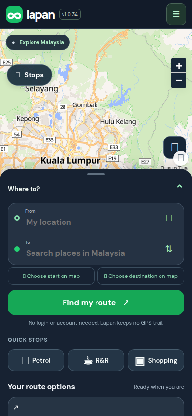

## Purpose

When TuJu became popular overnight it stopped working and left people stranded. A busy or broken Lapan server should not stop a returning user from opening the app.

## Changes (what you will notice)

A small helper (a "service worker") remembers Lapan's own files. If the server does not answer within 4 seconds, or answers with an error page, the app opens from the last saved copy instead. A healthy server always wins, so updates still arrive normally. **Routes, traffic, search and counters are never saved**, so they are either current or visibly fail. It only helps people who have opened Lapan before.

## Testing

**Screenshots**


*Taken with the server switched off: the app still opened from the saved copy.*

**Try it yourself, by hand**

1. Open the app once on a computer and wait a few seconds.
2. In the browser's developer tools, Application tab, Service Workers. Expected: `activated and is running`.
3. In the Network tab tick **Offline**, then reload. Expected: the app still opens (the planner appears).
4. Untick Offline and reload. Expected: normal again.
5. Planning a route while offline shows the usual message that routing is unavailable. That is intended.

**Run the automated checks** (about 10 seconds, no accounts or keys needed)

```sh
git remote add dandycrypto https://github.com/dandycrypto/lapan-malaysia.git   # first time only
git fetch dandycrypto pr/06-offline-shell
git switch --detach FETCH_HEAD
npm run build && npm test
```

Expected: the last line reads `32 of 32 test files passed`. Result when I ran it on commit `8752b9d`: **32 of 32 test files passed**.

A combined copy of the whole series (every PR together, not this PR alone) runs at https://lapan-test.dysolvit.com if you would rather look at it on a phone. It may be a little behind the latest commits.

**What I have not tested**

- Not tested on iPhone Safari, which handles service workers slightly differently.
- Not tested on a real iPhone (Safari) or a real Android phone. Everything was checked in desktop Chrome sized like a phone (390 x 844).
- Not tested with real GPS while driving. A recorded drive along a real road was replayed instead.
- Not tested against live TomTom. The route in the replay is a fixed copy, so real routing, traffic and tolls were not exercised.
- Not load tested.

## Dependencies

Needs the bundled-Leaflet PR merged first. Without it the map library still comes from unpkg.com, and the app cannot fully start from the saved copy.

## Impact

- No new paid services or API calls. No permission prompts.
- Each phone keeps a few MB of Lapan's own files in browser storage, plus the larger map files after first use.
- **Risk to know:** if the server shows errors for a long time, people see the last saved version. I chose this on purpose (an older working app beats an error page).
- **Rollback:** remove `web/offline.js` and its script tag, ship, and the helper stops being installed. Browsers that already have it will keep it until it is unregistered, so a kill-switch update would be needed for an emergency.
- Found and fixed during testing: the first version only handled dead connections; error pages from an overloaded server are now handled too.

---
Built with AI assistance (Claude Code). The tests above were run on the commit shown. Part of a 10 PR series; merge in order with rebase, and each later PR shrinks as the earlier ones land. `UNRELEASED.md` will conflict between PRs because each adds one bullet; keep both. Per `AGENTS.md`, nothing here bumps the version or edits the changelog.

🤖 Generated with [Claude Code](https://claude.com/claude-code)
