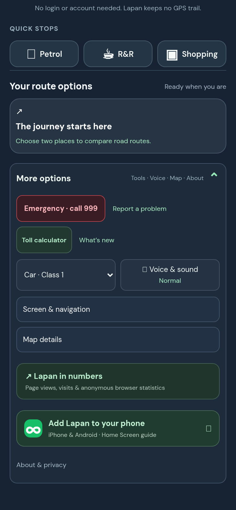
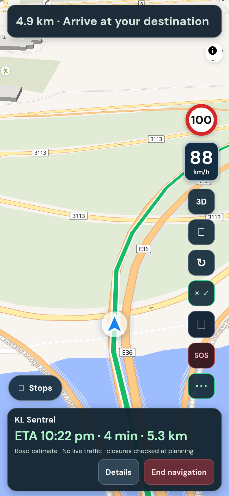

## Purpose

TuJu reviewers complained there was no way to report a problem from inside the app, and Lapan had the same gap. A navigation app should also make it quick to call for help.

## Changes (what you will notice)

- **Menu, More options, Report a problem** opens a GitHub form with a short template. Only the Lapan version number is filled in. No location, route or device details are attached.
- **Emergency · call 999** opens the phone's dialler with 999 typed in. Nothing is dialled until the person presses call.
- While driving, an **SOS** button appears after tapping ⋯.
- About & privacy explains both in plain words.

## Testing

**Screenshots**



*Left: the Menu. Right: the SOS button after tapping ⋯.*

**Try it yourself, by hand**

1. Open Menu. Expected: Emergency and Report a problem are the first row (picture above).
2. Tap **Report a problem**. Expected: a GitHub issue page opens with the template. Check the page text for any place names or coordinates. Expected: none.
3. On a phone, tap **Emergency**. Expected: the dialler opens showing 999. Do not press call.
4. While navigating, tap ⋯. Expected: a red SOS button appears. Before tapping ⋯ it should not be visible.

**Run the automated checks** (about 10 seconds, no accounts or keys needed)

```sh
git remote add dandycrypto https://github.com/dandycrypto/lapan-malaysia.git   # first time only
git fetch dandycrypto pr/07-help-links
git switch --detach FETCH_HEAD
npm run build && npm test
```

Expected: the last line reads `33 of 33 test files passed`. Result when I ran it on commit `80fc4b9`: **33 of 33 test files passed**.

A combined copy of the whole series (every PR together, not this PR alone) runs at https://lapan-test.dysolvit.com if you would rather look at it on a phone. It may be a little behind the latest commits.

**What I have not tested**

- Not tested on a real iPhone (Safari) or a real Android phone. Everything was checked in desktop Chrome sized like a phone (390 x 844).
- Not tested with real GPS while driving. A recorded drive along a real road was replayed instead.
- Not tested against live TomTom. The route in the replay is a fixed copy, so real routing, traffic and tolls were not exercised.
- Not load tested.

## Dependencies

Works alone.

## Impact

- No new services or costs. The report form is on GitHub (`alanchungRM/lapan-malaysia`). If you prefer another channel (email, WhatsApp), it is a one-line change.
- No permissions. Only 999 is used. No other phone numbers were added.
- On a computer the 999 link may ask which app to open. That is the browser's normal behaviour.

---
Built with AI assistance (Claude Code). The tests above were run on the commit shown. Part of a 10 PR series; merge in order with rebase, and each later PR shrinks as the earlier ones land. `UNRELEASED.md` will conflict between PRs because each adds one bullet; keep both. Per `AGENTS.md`, nothing here bumps the version or edits the changelog.

🤖 Generated with [Claude Code](https://claude.com/claude-code)
