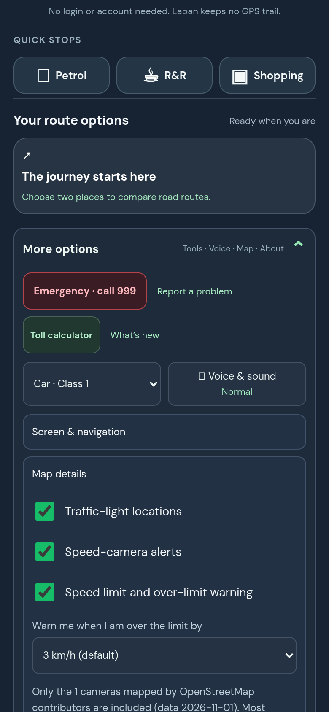

## Purpose

Waze lets people decide how far over the limit before they are warned. Lapan had one fixed setting. Some drivers want an earlier warning, others find 3 km/h too strict.

## Changes (what you will notice)

A new setting under **Menu, More options, Map details**: "Warn me when I am over the limit by" 3 km/h (default, same as before), 5 km/h or 10 km/h. The speed turns amber at your margin and red 7 km/h beyond it. The choice is remembered on that phone.

## Testing

**Screenshots**


*The new setting, with the camera note underneath.*

**Try it yourself, by hand**

1. Open Menu, More options, Map details. Expected: the setting is there, with 3 km/h selected.
2. Choose 10 km/h, reload the page. Expected: it still says 10 km/h.
3. While driving (on a real drive) 12 km/h over the limit: with 3 km/h you get red, with 10 km/h you get amber.

**Run the automated checks** (about 10 seconds, no accounts or keys needed)

```sh
git remote add dandycrypto https://github.com/dandycrypto/lapan-malaysia.git   # first time only
git fetch dandycrypto pr/08-speeding-margin
git switch --detach FETCH_HEAD
npm run build && npm test
```

Expected: the last line reads `33 of 33 test files passed`. Result when I ran it on commit `625e6d9`: **33 of 33 test files passed**.

A combined copy of the whole series (every PR together, not this PR alone) runs at https://lapan-test.dysolvit.com if you would rather look at it on a phone. It may be a little behind the latest commits.

**What I have not tested**

- Not tested on a real iPhone (Safari) or a real Android phone. Everything was checked in desktop Chrome sized like a phone (390 x 844).
- Not tested with real GPS while driving. A recorded drive along a real road was replayed instead.
- Not tested against live TomTom. The route in the replay is a fixed copy, so real routing, traffic and tolls were not exercised.
- Not load tested.

## Dependencies

Needs the speed-limit PR (it extends that code).

## Impact

- No new services, costs or permissions. It stores one small value in the browser (`lapan-speed-margin`).
- Default behaviour is unchanged.

---
Built with AI assistance (Claude Code). The tests above were run on the commit shown. Part of a 10 PR series; merge in order with rebase, and each later PR shrinks as the earlier ones land. `UNRELEASED.md` will conflict between PRs because each adds one bullet; keep both. Per `AGENTS.md`, nothing here bumps the version or edits the changelog.

🤖 Generated with [Claude Code](https://claude.com/claude-code)
