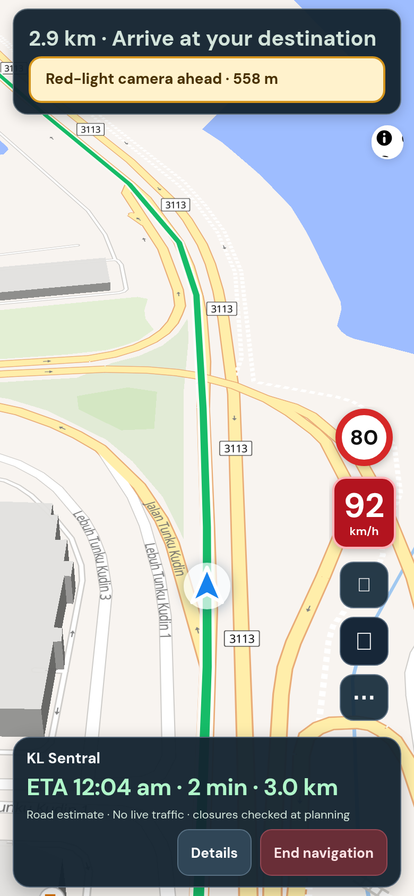
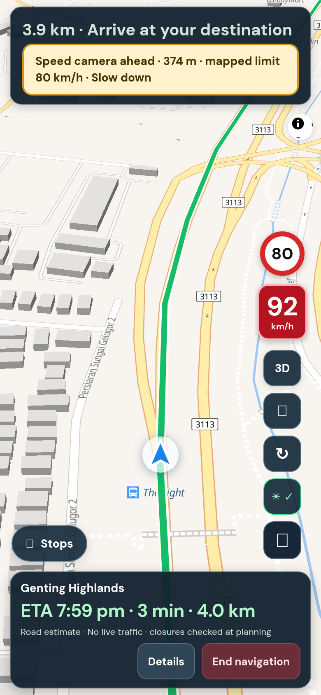

## Purpose

Speed-camera alerts asked a public map server (Overpass) for every camera in Malaysia the first time anyone opened the app. When I checked, that server answered "at capacity", and a slow answer could leave a user waiting about 24 seconds. Red-light cameras also got speed-camera wording. And the app never told people how few cameras are actually mapped.

## Changes (what you will notice)

- The camera list now ships with Lapan (28 KB), so alerts do not depend on a public server.
- **Red-light cameras** say "Red-light camera ahead" and never talk about speed. Speed cameras still mention the road's limit and say "Slow down" when you are over.
- The app is honest about coverage. It says how many cameras it knows about and that mobile cameras and police traps are not covered.

**The honest picture:** OpenStreetMap volunteers have mapped only **293** cameras across Malaysia, Singapore and Brunei (244 speed, 49 red-light). Real enforcement points are far more. The real fix is community reporting, which would need a small backend and is not part of this PR.

## Testing

**Screenshots**



*Left: a red-light alert with no speed claim. Right: a speed camera alert naming the road limit.*

**Try it yourself, by hand**

1. Menu, More options, Map details. Expected: a note says how many cameras are included and that most enforcement points are not covered.
2. Drive towards a mapped camera (on a real drive). Expected: a banner and spoken alert within 600 m. Speed camera: "Speed camera ahead, in 434 metres. Mapped limit 80 kilometres per hour. Slow down." (the last sentence only when over). Red-light: "Red-light camera ahead, in 598 metres."
3. `npm test camera` also checks the data file is well formed, so a bad refresh fails before release.

**Run the automated checks** (about 10 seconds, no accounts or keys needed)

```sh
git remote add dandycrypto https://github.com/dandycrypto/lapan-malaysia.git   # first time only
git fetch dandycrypto pr/09-camera-data
git switch --detach FETCH_HEAD
npm run build && npm test
```

Expected: the last line reads `34 of 34 test files passed`. Result when I ran it on commit `9989b39`: **34 of 34 test files passed**.

A combined copy of the whole series (every PR together, not this PR alone) runs at https://lapan-test.dysolvit.com if you would rather look at it on a phone. It may be a little behind the latest commits.

**What I have not tested**

- Not tested on a real iPhone (Safari) or a real Android phone. Everything was checked in desktop Chrome sized like a phone (390 x 844).
- Not tested with real GPS while driving. A recorded drive along a real road was replayed instead.
- Not tested against live TomTom. The route in the replay is a fixed copy, so real routing, traffic and tolls were not exercised.
- Not load tested.

## Dependencies

Needs the speed-limit PR (camera alerts use its road limits).

## Impact

- **Removes** a live dependency on a public map server and the Worker code for it. No new services, costs or permissions.
- Adds a 28 KB data file. It does not update by itself: re-run `scripts/extract-speed-cameras.py` with a fresh OpenStreetMap download to refresh it (README explains).
- **Limits:** coverage is thin (above). The camera's facing direction is not used because the map data is ambiguous about it; on a divided road a camera on the other carriageway within 25 m could trigger an alert. The list may include a few cameras in Singapore, because the source file covers Malaysia, Singapore and Brunei.

---
Built with AI assistance (Claude Code). The tests above were run on the commit shown. Part of a 10 PR series; merge in order with rebase, and each later PR shrinks as the earlier ones land. `UNRELEASED.md` will conflict between PRs because each adds one bullet; keep both. Per `AGENTS.md`, nothing here bumps the version or edits the changelog.

🤖 Generated with [Claude Code](https://claude.com/claude-code)
