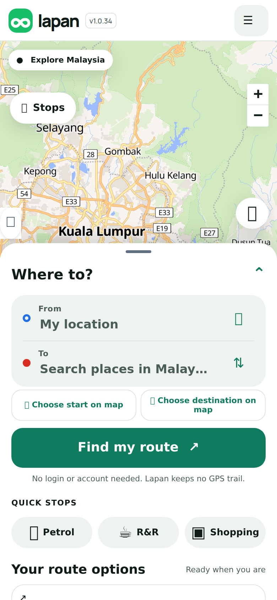
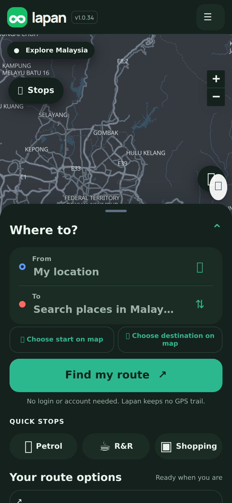
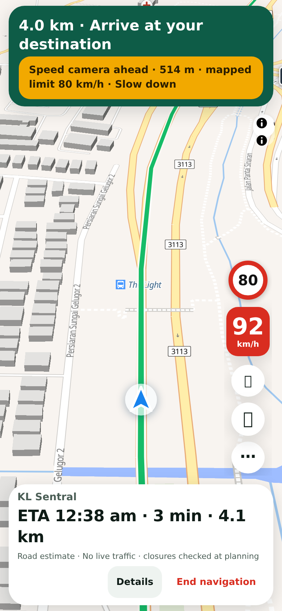
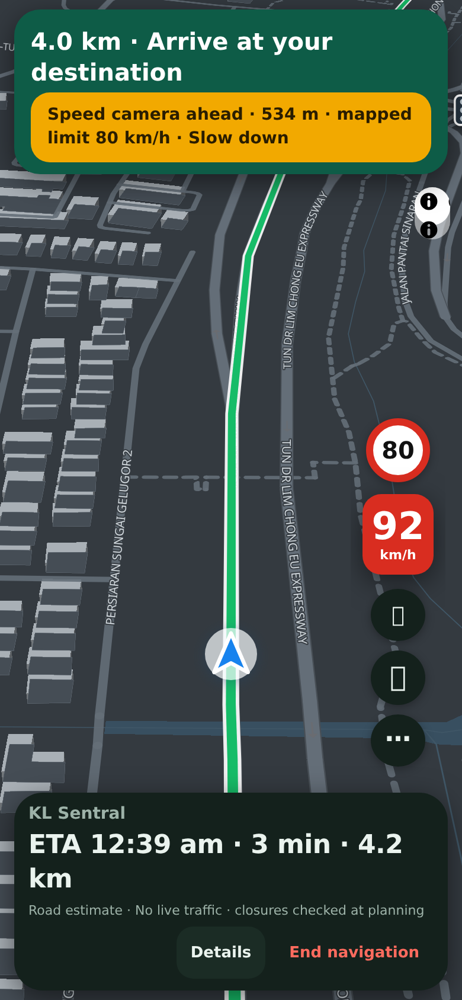

## Purpose
The screens look inconsistent, and drivers expect day and night to switch by themselves like Waze and Google Maps. This adds an **opt-in new look** with automatic day and night. Nothing changes for anyone who does not opt in. Plan: https://github.com/dandycrypto/lapan-malaysia/blob/pr-assets/ui-revamp/UI-REVAMP-PLAN.md

## Changes
Turn on with `?ui=2` on the address, or Menu > More options > Try the new look. Remembered per phone; `?ui=1` turns it off.
- Cleaner colours and type, accessible contrast (WCAG), visible focus rings, 44 px touch targets, respects "reduce motion".
- **Auto day and night follows sunrise and sunset where you are.** Interface, map style and browser top bar switch together, checked each minute. Choosing Day or Night always wins.
- Colours, type and sizes only. Layout and scripts are untouched.

<p></p>

## Testing
By hand: open `?ui=2`; Menu > More options > Screen & navigation > Map appearance. Expected: "Auto - Sunrise and sunset". Choose Night, then Day: the whole app and map change together. Auto should match a sun table (2 Nov: Kuala Lumpur 06:56 / 18:56, Kuching 06:20 / 18:23, Kota Kinabalu 06:02 / 17:56). `?ui=1` returns to the classic look.

Automated:
```sh
git remote add dandycrypto https://github.com/dandycrypto/lapan-malaysia.git
git fetch dandycrypto ui/u1-new-look-foundation && git switch --detach FETCH_HEAD
npm run build && npm test
```
Result on commit `d87494c`: **39 of 39 test files passed**. New tests: `sun` (checked against physics, and fails if the formula is broken), `theme` (fake clock and location), `ui2-switch`, `ui2-map`, `ui2-contrast` (every text and background pair in both themes; it caught and I fixed a low-contrast red chip). Live copy of the whole series: https://lapan-test.dysolvit.com (may not include this PR yet).

**Not tested:** a real dawn or dusk switch (maths and a fake clock only), iPhone Safari and real Android, real GPS and live TomTom. Dialogs get a basic recolour only, polished in a later step.

## Dependencies
Needs PRs 0 to 9 merged first (it recolours elements they add). With the switch off it changes nothing.

## Impact
No new services, API calls, costs or permissions. Everyone downloads three small scripts (about 1.5 KB compressed); only opt-in users also get the 12 KB stylesheet (2.5 KB compressed). Location is used only if the browser already allows it (never prompts), and only the nearest whole degree is remembered; default is Kuala Lumpur. Google Fonts still load in this step. Rollback: remove four script tags.

---
Built with AI assistance (Claude Code). Tests were run on the commit shown. Part of the series; merge in order with rebase. `UNRELEASED.md` conflicts textually between PRs; keep both bullets. Nothing here bumps the version.

🤖 Generated with [Claude Code](https://claude.com/claude-code)
