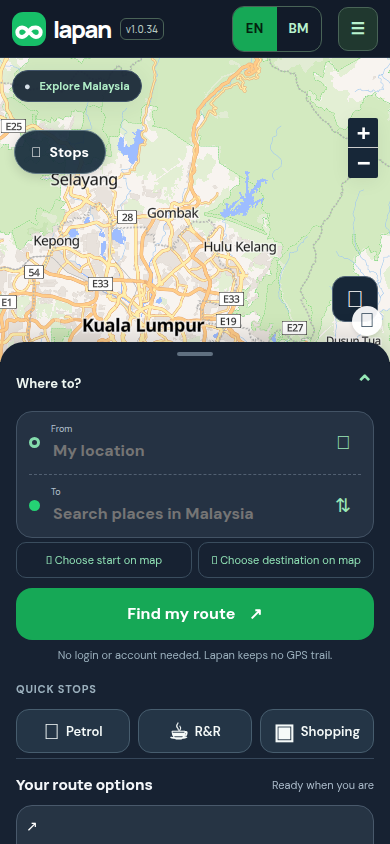
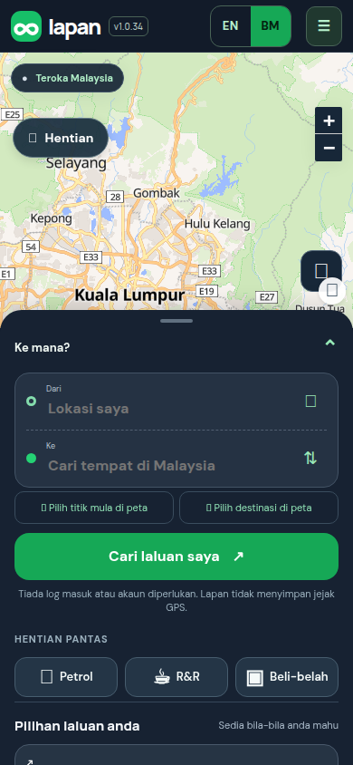
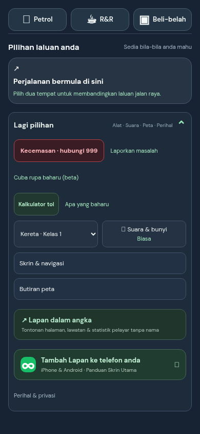
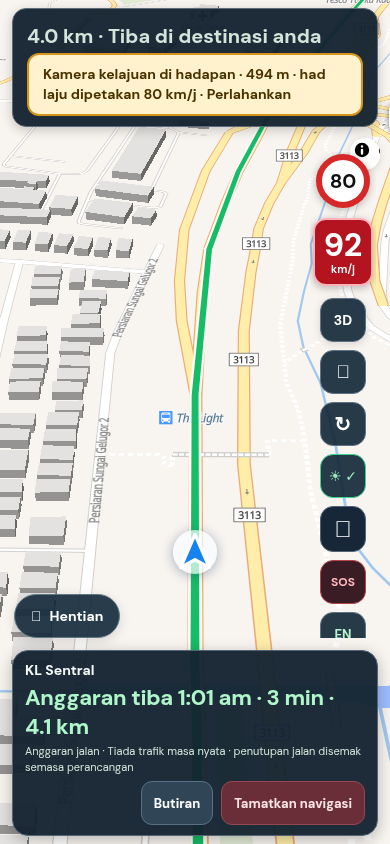

## Purpose
Many Lapan drivers read Bahasa Malaysia first, and every screen was English only. This adds Bahasa Malaysia everywhere, with a one-tap **EN | BM** switch.

## Changes
- **EN | BM switch** in the header, plus a language button under **More** while driving. It switches in place with no reload, so a trip is never interrupted. First visit follows the phone's language list; your choice is remembered.
- Whole screens, menus, labels, messages, the install guide and the privacy text are in Malay. Turn instructions, speed-camera and speed-limit alerts are built in Malay too.
- **Voice:** spoken guidance is Malay only when the phone has a Malay voice. Otherwise Lapan keeps speaking English so the voice stays understandable.
- **Every future screen change needs both languages.** Tests fail if page text has no Malay entry, and a PR template now asks for it.

<p></p>

## Testing
By hand: open the app, tap **BM** (top right). Expected: everything turns Malay; tap **EN** and it returns exactly. Plan a route and start navigation; open **More** and tap the language button mid-trip. Expected: the language changes and the trip continues.

Automated:
```sh
git remote add dandycrypto https://github.com/dandycrypto/lapan-malaysia.git
git fetch dandycrypto i18n/bahasa-malaysia && git switch --detach FETCH_HEAD
npm run build && npm test
```
Result on commit `71e618e`: **42 of 42 test files passed**. New: `i18n` (engine), `i18n-coverage` (every page text has Malay; placeholders, tags, length and terms are linted), `i18n-directions` (every manoeuvre and alert in Malay, English unchanged). I broke each rule on purpose to confirm it fails.

**Not tested:** review by a native speaker (sheet of all 348 translations: https://github.com/dandycrypto/lapan-malaysia/blob/pr-assets/i18n/BM-REVIEW.md), a real Malay phone voice, iPhone Safari and real Android, real GPS. The public changelog and statistics page stay English.

## Dependencies
Needs the earlier series merged first, including UI 1 (it translates their screens).

## Impact
No new services, API calls, costs or permissions. English users download one 3.4 KB (compressed) script; the 11 KB Malay dictionary is fetched only by Malay users. The language choice is saved in this browser. If the Malay file cannot load, the page stays English. Rollback: remove the `i18n.js` script tag.

---
Built with AI assistance (Claude Code); translations are machine-assisted and need native review. Part of the series; merge in order with rebase. `UNRELEASED.md` conflicts textually between PRs; keep both bullets. Nothing here bumps the version.

🤖 Generated with [Claude Code](https://claude.com/claude-code)
