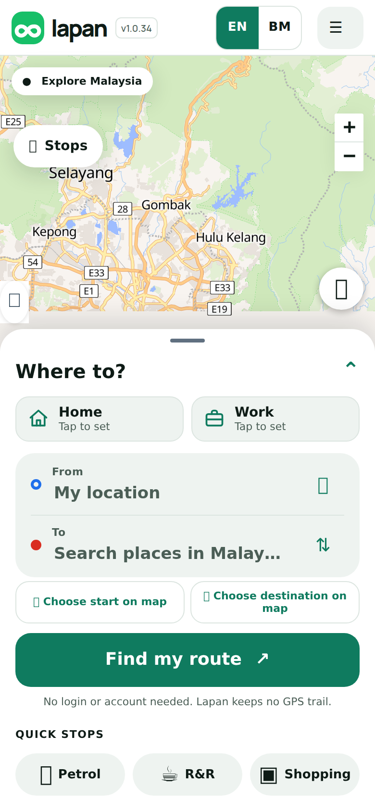
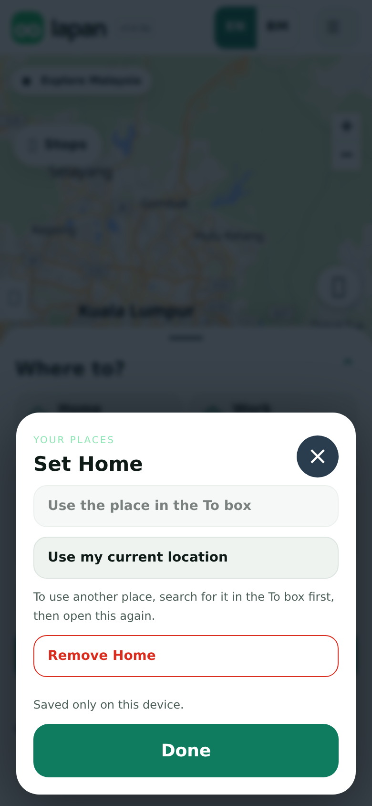
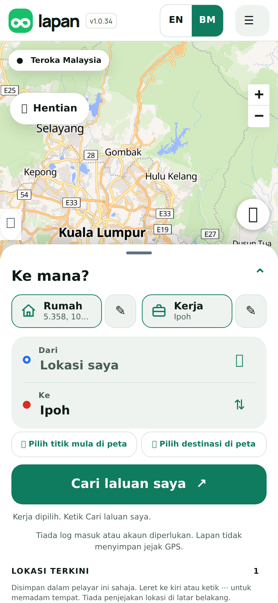
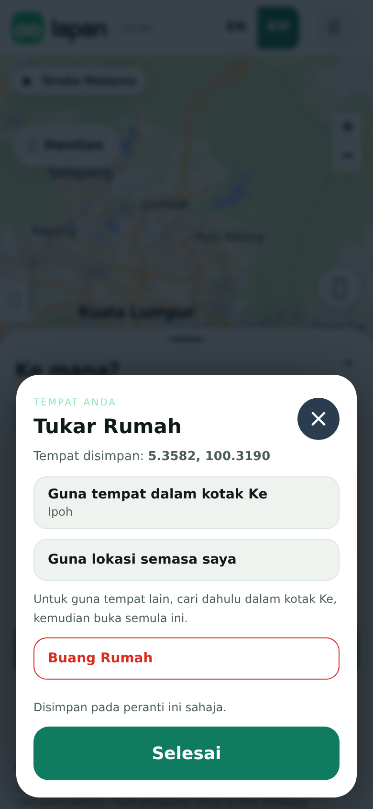

## Purpose
Most trips start or end at home or at work, yet every trip needed the place typed again. This adds two one-tap shortcuts, **Home** and **Work**, at the top of the planner, as in Waze.

## Changes
- Two chips above the From and To boxes. Tap an empty chip to save a place. Tap a saved chip and it fills the destination, then moves you to **Find my route**.
- To save, choose either the place already in the To box, or **Use my current location**. The pencil next to a saved chip changes or removes it.
- Saved only on this device. Nothing is uploaded, and no account is needed. Places outside Malaysia or damaged saved data are ignored.
- Large tap targets (at least 44 px), keyboard focus rings, and the same look in the classic and new designs. English and Bahasa Malaysia (Home is Rumah, Work is Kerja).

<p></p>

## Testing
By hand: open the app, tap **Home**, then **Use my current location**. Expected: the chip now shows the place. Type **Ipoh** in To, pick it, tap **Work**, then **Use the place in the To box**. Reload the page. Expected: both chips are still there. Tap **Work**. Expected: To shows Ipoh and **Find my route** is focused. Tap **BM**. Expected: Rumah and Kerja. Tap the pencil, then **Remove Home**.

Automated:
```sh
git remote add dandycrypto https://github.com/dandycrypto/lapan-malaysia.git
git fetch dandycrypto feat/home-work && git switch --detach FETCH_HEAD
npm run build && npm test
```
Result on commit `d96c0bd`: **43 of 43 test files passed**. New `saved` test (places must be in Malaysia, saved data survives restarts, corrupt or blocked storage is safe, every message has Bahasa Malaysia). I broke the code five ways on purpose to confirm the test fails. A real-browser run on a phone-sized screen covered the steps above in both languages with no console errors.

**Not tested:** real iPhone Safari and Android, a real address name for the current location (it is shown by its coordinates), review of the Malay by a native speaker.

## Dependencies
Needs the Language PR (and so UI 1) merged first, because it adds Malay strings to the dictionary. It does not depend on any other new feature.

## Impact
New 3 KB file, no new services, API calls, costs or permissions beyond the location prompt the app already uses. Rollback: remove the `saved.js` script tag and the chips markup.

---
Built with AI assistance (Claude Code). Part of the series; merge in order with rebase. `UNRELEASED.md` conflicts textually between PRs; keep both bullets. Nothing here bumps the version.

🤖 Generated with [Claude Code](https://claude.com/claude-code)
