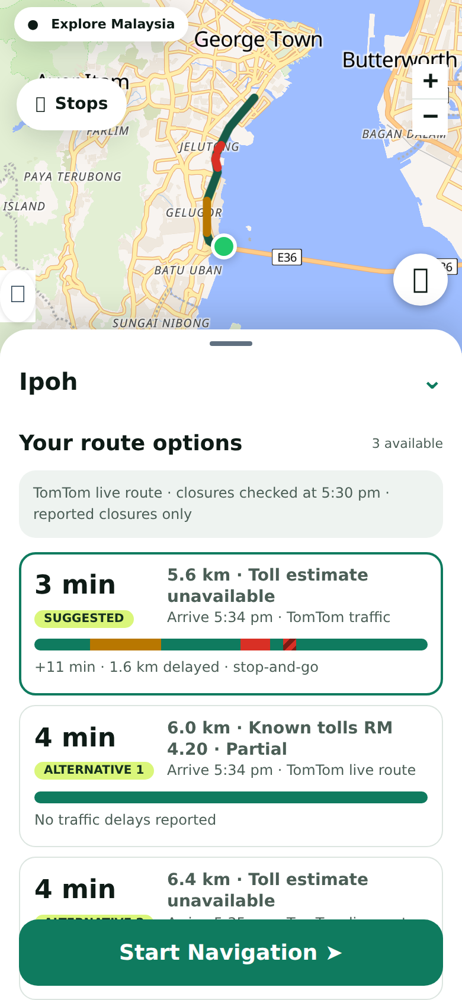
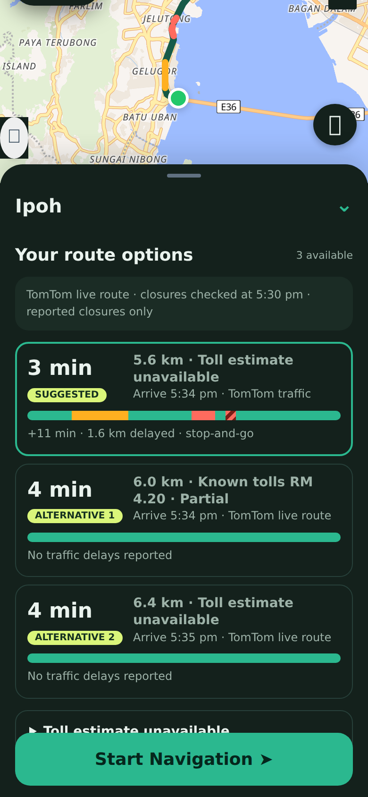
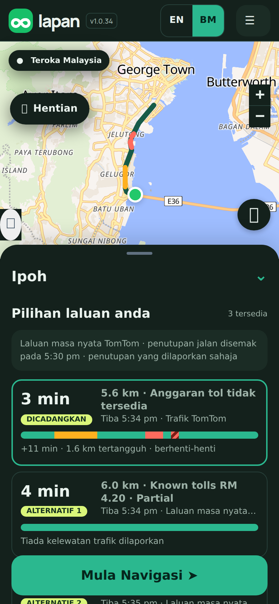

## Purpose
Choosing between routes meant comparing minutes only. You could not see where the slow part was. This adds a colour bar to each route option, like Waze and Google Maps, so you can see at a glance how much of a route is slow and how bad it is.

## Changes
- Each route card gets a bar for the whole trip: green for flowing, amber for slow, red for heavy, red with stripes for stop-and-go. A one-line summary says the same in words, for example *+11 min · 1.6 km delayed · stop-and-go*, so colour is never the only signal.
- The route you select is also coloured on the map (stripes become a dashed line).
- Routes without live traffic data, such as the basic fallback routing, show no bar rather than guessing.
- Behind it, the route service now passes along TomTom's slow-traffic sections (at most 300, checked and trimmed). Closed roads still reject a route, and roadworks are left out of this bar.
- Day and night colours are checked for contrast. English and Bahasa Malaysia.

<p></p>

## Testing
By hand: plan any route with live traffic on. Expected: every route option shows a bar under the distance, and a sentence below it. The selected route shows coloured stretches on the map where it is slow. Tap another option. Expected: the map colours change to match it. Tap **BM**. Expected: the sentence turns Malay and the bar stays.

Automated:
```sh
git remote add dandycrypto https://github.com/dandycrypto/lapan-malaysia.git
git fetch dandycrypto feat/traffic-bar && git switch --detach FETCH_HEAD
npm run build && npm test
```
Result on commit `486399c`: **45 of 45 test files passed**. New `traffic-bar` (levels, overlaps, bad data, no claim without live data, bar widths, Malay sentences, colour contrast against day and night surfaces) and `route-traffic` (what the service passes on and drops). The first contrast check failed on my first amber and I darkened it. I broke the code nine ways on purpose; eight were caught and the ninth changes nothing observable. A real-browser run on a phone-sized screen (day, night, Malay, switching routes, starting navigation) had no console errors.

**Not tested:** a live TomTom response. The test used a fixture shaped like TomTom's documented route sections, so the first real route should be checked on the test site with a TomTom key. Also real phones, and review of the Malay by a native speaker. The bar does not update while driving yet.

## Dependencies
Needs the Language PR (and so UI 1) merged first. It does not depend on any other new feature. It includes the compact route rows change (also its own PR).

## Impact
No new services or costs: the route request already asks TomTom for traffic sections. The route response grows by a few hundred bytes. Rollback: remove the `traffic-bar.js` script tag; the route service field is harmless.

---
Built with AI assistance (Claude Code). Part of the series; merge in order with rebase. `UNRELEASED.md` conflicts textually between PRs; keep both bullets. Nothing here bumps the version.

🤖 Generated with [Claude Code](https://claude.com/claude-code)
