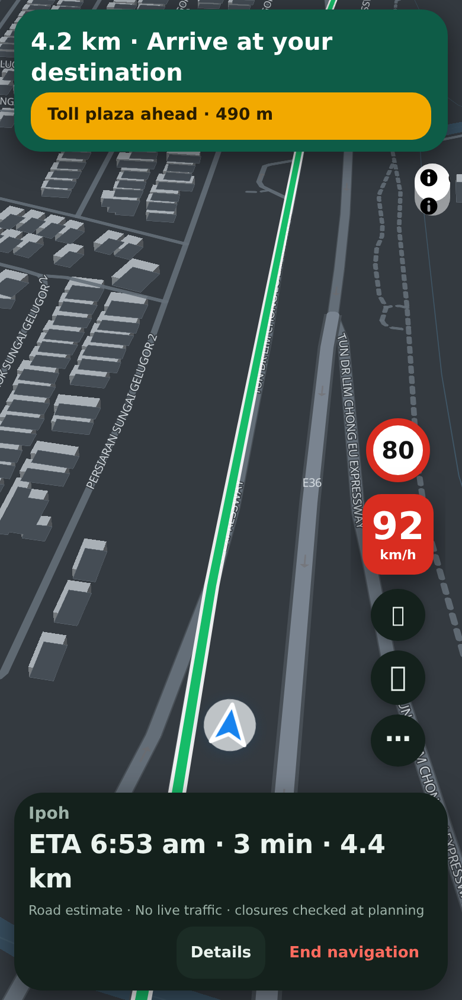
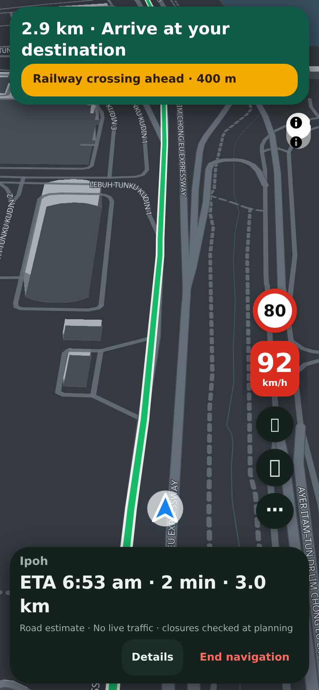
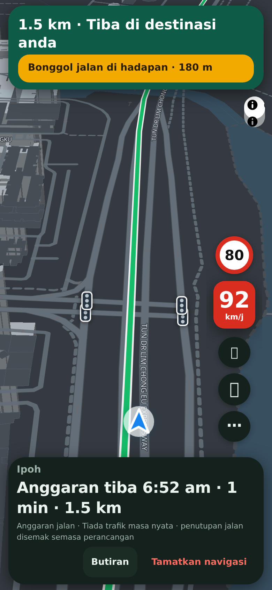
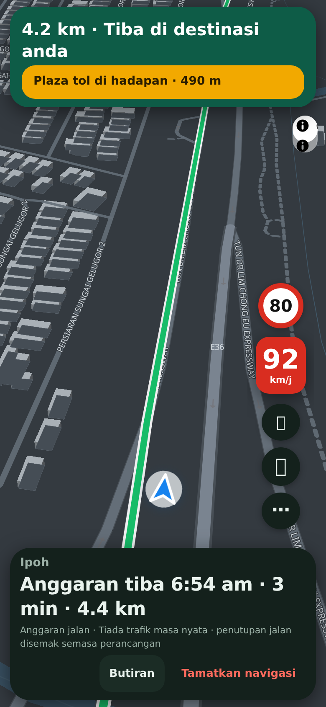

## Purpose
Lapan warned about speed cameras but not about the other things that surprise drivers: a toll plaza, a railway crossing, a speed bump or a sharp bend. This adds those warnings while you drive, as Waze does.

## Changes
- One banner at the top while driving, for example *Railway crossing ahead · 400 m*, plus a single spoken heads-up for each hazard. Only one banner shows at a time: whichever of a camera or a hazard is nearer.
- **Toll plazas, railway crossings and speed bumps** come from OpenStreetMap, bundled with the app (574 toll points, 337 crossings, 25,121 bumps, in a 160 KB download that loads when navigation starts). Bumps and crossings are kept only if they lie on a drivable road. Several bumps close together become one alert.
- **Sharp curves** are found from the shape of your own route (a turn of 60 degrees or more within about 80 metres), so they need no map data. Turns that are already announced as a turn are not repeated as a curve.
- A switch, **Road hazard alerts**, under Map details turns them off. English and Bahasa Malaysia, spoken and written.
- The screen says that only part of these points are mapped and that nobody should rely on it alone.

<p></p>

## Testing
By hand: start navigation on a route that passes a toll plaza. Expected: *Toll plaza ahead* appears about 600 m before it, with the distance counting down, and is spoken once. Tap **BM**. Expected: the same banner in Malay. Switch **Road hazard alerts** off under Map details. Expected: no more hazard banners.

Automated:
```sh
git remote add dandycrypto https://github.com/dandycrypto/lapan-malaysia.git
git fetch dandycrypto feat/hazard-alerts && git switch --detach FETCH_HEAD
npm run build && npm test
```
Result on commit `451c1da`: **43 of 43 test files passed**. New `hazards` test (curve detection on straight, gentle, sharp, rounded and zig-zag roads; junction turns and roundabouts excluded; mapped points matched to the route; merging; range and order; every sentence in English and Malay; shape and limits of the shipped data). I broke the code eleven ways on purpose and two went unnoticed, so I added tests until all eleven failed. A real-browser run replayed a drive: toll, railway and bump alerts appeared in order, with distance and speech, never alongside another banner, in both languages. On two real routes (KL to Genting and KL to Penang) the curve detector found 29 and 1 curves, which fits a mountain road against a highway.

**Not tested:** a sharp-curve alert in the browser (it is covered by unit tests and real routes, but the replayed drive had no sharp curve), real phones, real toll plazas on a live drive, and a Malay-speaker review. Mapped points are incomplete, so a missing alert does not mean nothing is there.

## Dependencies
Needs the Language PR (and so UI 1) merged first. It does not depend on any other new feature.

## Impact
A new 515 KB data file (160 KB compressed), fetched once a day at most and only when navigation starts. No new services or costs. The camera banner code gains one line so the two banners can share the space. Rollback: remove the `hazards.js` script tag.

---
Built with AI assistance (Claude Code). Part of the series; merge in order with rebase. `UNRELEASED.md` conflicts textually between PRs; keep both bullets. Nothing here bumps the version.

🤖 Generated with [Claude Code](https://claude.com/claude-code)
