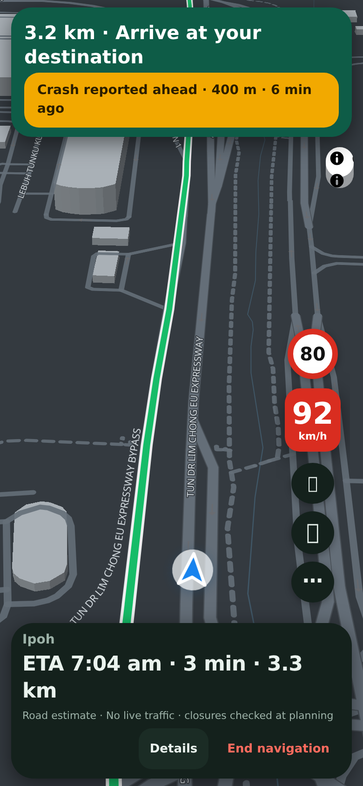
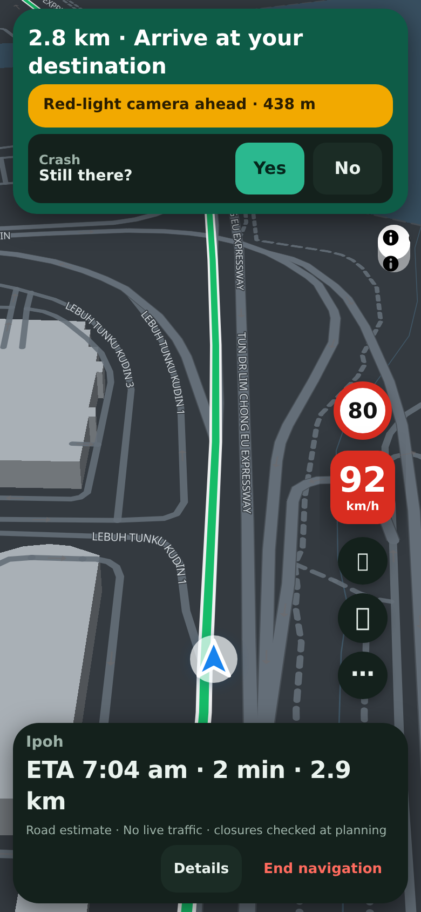
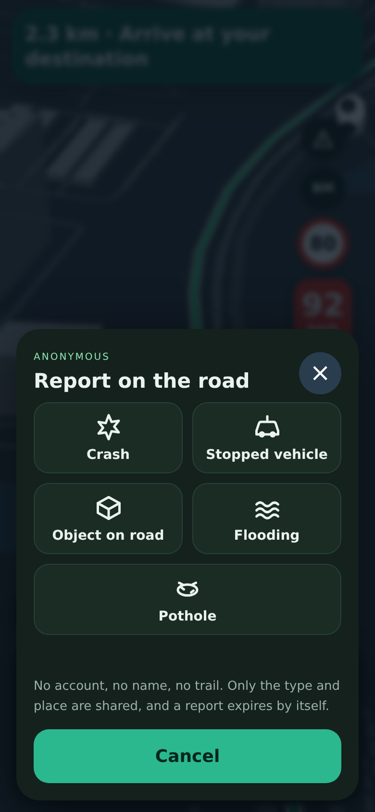
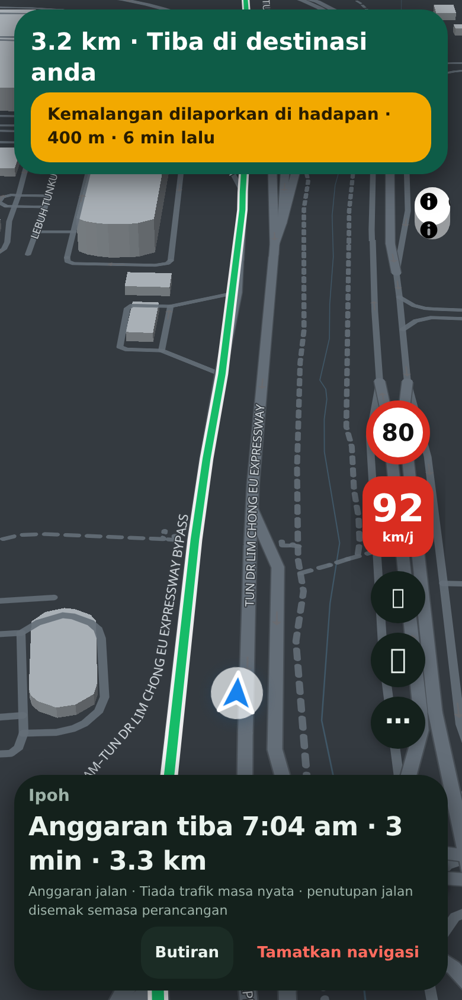
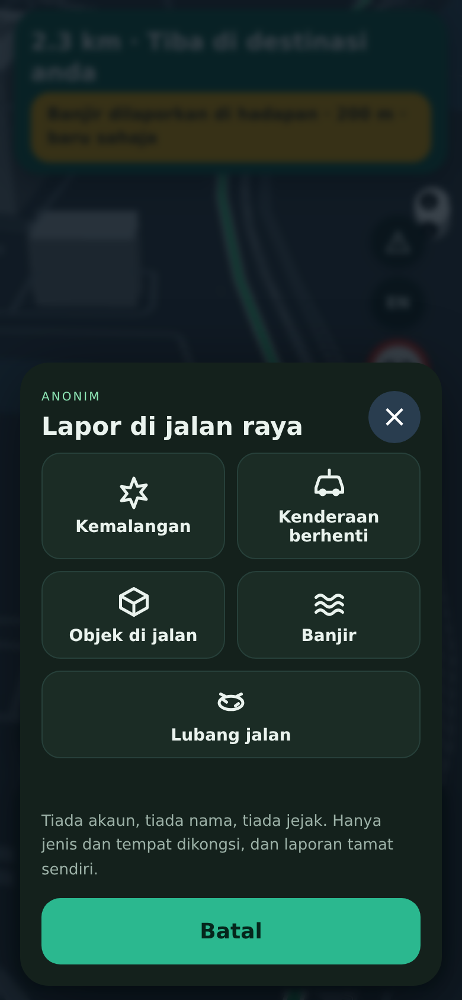

## Purpose
Drivers know about a crash, a flood or a pothole minutes before any app does. This lets them tell the drivers behind them in one tap, as Waze does, without an account and without anyone being tracked. Forced login and worries about tracking were two of the complaints about TuJu, so this is anonymous by design.

## Changes
- A **Report** button under **More** on the driving screen. Five choices, each one tap: Crash, Stopped vehicle, Object on road, Flooding, Pothole. Large buttons, no typing.
- Drivers behind see *Crash reported ahead · 400 m · 6 min ago*, hear it once, and see a pin on the map. Within 120 m they are asked **Still there? Yes / No**. Two *No* answers outnumbering the *Yes* answers remove it, and each *Yes* keeps it alive longer.
- **Anonymous by design.** No account, no name, no free text, and the database has no column for who sent it. Only the type and a place rounded to about a metre are stored. There is **no police, roadblock or camera reporting** (PDRM has asked people not to share roadblocks).
- **Reports expire by themselves**: crash 2 hours, stopped vehicle and object 1 hour, flooding 3 hours, pothole 3 days. A second report of the same kind within 150 m counts as a confirmation, not a duplicate pin.
- **Abuse limits**: same-origin only, six reports a minute per address, 20,000 live reports in total, and the existing optional edge limiter covers it too. The privacy text in the app is updated in both languages.
- English and Bahasa Malaysia, written and spoken.

<p></p>

## Testing
By hand: on a test site with the database step applied, start navigation, tap **More**, then the red-triangle **Report** button. Expected: five choices. Tap **Flooding**. Expected: *Thank you*, and the sheet closes. On a second phone driving the same road, expected: *Flooding reported ahead*, a pin on the map and, within 120 m, **Still there?**. Tap **Yes**. Tap **BM**. Expected: the same in Malay. Without the database step, expected: no Report button at all and driving works as before.

Automated:
```sh
git remote add dandycrypto https://github.com/dandycrypto/lapan-malaysia.git
git fetch dandycrypto feat/community-reports && git switch --detach FETCH_HEAD
npm run build && npm test
```
Result on commit `2fb780d`: **44 of 44 test files passed**. New `reports` test runs the real service code against real SQLite using the real migration file (create, merge, expire per kind, votes, caps, validation, origin and size limits, rate limit, global cap, nothing about the sender stored, database failure shows no internals) and `reports-client` (placement on the route, range, refresh rules, wording in both languages, no police kind, privacy text). I broke the code 20 ways on purpose; 3 went unnoticed at first, so I added tests until all 20 failed. A real-browser drive checked the banner, spoken heads-up, the question, both votes, a report being sent (only kind and place leave the phone), map pins, Malay, and the case where the service is off.

**Not tested:** the real Cloudflare D1 database (the test uses SQLite, which D1 is built on, but the migration has not been applied to a live D1), real phones and real roads, Malay by a native speaker, and how many fake reports a determined abuser could post from many addresses. Moderation is manual for now (delete a row in the D1 console). Reports are not shown while planning a trip, only while driving.

## Dependencies
Needs the Language PR (and so UI 1) merged first. **Needs one step on the server: apply `drizzle/0002_community_reports.sql` to the existing D1 database `DB`** (the same database that holds visitor statistics). Nothing else changes. Does not depend on the other new features.

## Impact
One new table, three small endpoints, two kilobytes-per-minute of polling only while navigating. No new services, accounts or costs beyond D1 reads and writes, which are small. Rollback: remove the `reports.js` script tag and leave the table, or drop it.

---
Built with AI assistance (Claude Code). Part of the series; merge in order with rebase. `UNRELEASED.md` conflicts textually between PRs; keep both bullets. Nothing here bumps the version.

🤖 Generated with [Claude Code](https://claude.com/claude-code)
