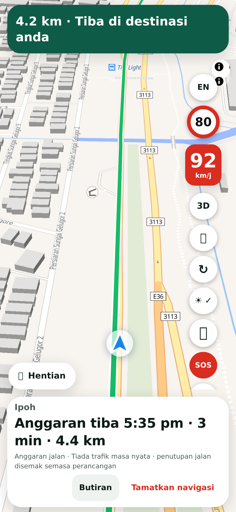
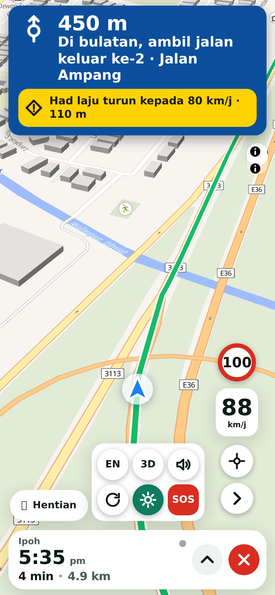
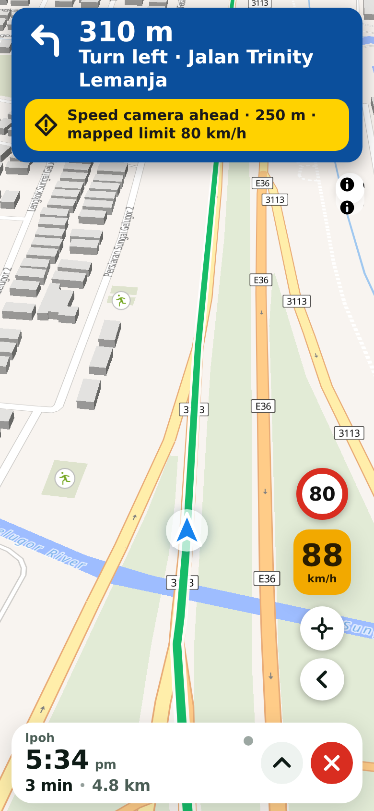
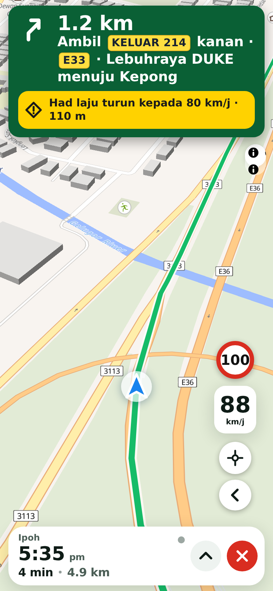

## Purpose
On a small phone the driving screen was hard to read: the turn text was small, the arrival time, minutes and kilometres were all the same size, Malay words were long, and once More was opened its arrow button slid under the trip bar so it could not be closed. This reworks the screen along Waze's layout, with Malaysian sign colours and symbols instead of words. After the first review it was scaled down: type, buttons and spacing now follow Waze's proportions rather than filling the screen.

## Changes
- **Turn banner**: an arrow, the distance at about 30 px and the road name at 17 to 21 px, like Waze's proportions. It is about a third shorter than my first version. It is **blue for ordinary roads and green for expressways, ramps and exits**, like Malaysian guide signs. Alerts (camera, speed-limit drop) sit inside it as **yellow warning-sign panels** with a diamond symbol.
- **Trip bar**: arrival time first and biggest (about 28 px, *7:30 am*), then *3 min · 4.6 km* on a line under it. The long grey status sentence is gone (a small dot shows live traffic; the full text is under Details). Details and End navigation are now icon buttons (an up arrow and a red cross), 44 px.
- **More**: the shortcuts now open as a tray next to the controls. The toggle is an arrow that flips, stays in place and always closes it. The tray also closes when you tap the map, press Escape or leave it for 12 seconds.
- **Fewer words, more symbols**: locate, voice (four states), repeat, awake, details and stop use drawn icons. Bahasa Malaysia: the arrival label is now just *Tiba*.
- The new look only (`?ui=2`), except that the tray and its closing apply to both looks. Checked on 390 x 844, 360 x 640 and 320 x 568 screens.

<p></p>

## Testing
By hand: open the new look, plan a route and start navigation. Expected: a large banner at the top, the arrival time large at the bottom, two round buttons. Tap the arrow button above the trip bar. Expected: six shortcuts open beside it and the arrow flips. Tap the map. Expected: they close. Tap **BM**. Expected: the same screen in Malay with short words.

Automated:
```sh
git remote add dandycrypto https://github.com/dandycrypto/lapan-malaysia.git
git fetch dandycrypto ui/drive-restyle && git switch --detach FETCH_HEAD
npm run build && npm test
```
Result on commit `16e0ccb`: **43 of 43 test files passed**. New `drive-ui` test (the trip line split without losing any text, every turn arrow and the green/blue choice, banner structure, minimum text sizes, colour contrast of white on green and blue and black on yellow at 7:1 or better, Malay label) and a longer `drive-controls` test for the tray. The first green was only 6.6:1 so I darkened it. I broke the code 13 ways on purpose and all were caught. The test also fails if any driving text grows past a phone-friendly ceiling. A real-browser run on four phone setups (390, 360 and 320 wide, English and Malay) checks text sizes and the banner height, that nothing overlaps the trip bar, that every tray button is on screen and tappable, and each way of closing the tray. Console errors: none.

**Not tested:** real phones (this was checked in a desktop browser at phone sizes), real TomTom turn types (the replayed route only has start and arrive, so turns, exits and roundabouts were drawn from sample steps), colour-blind viewing (green and blue differ mainly by hue, so the arrow and exit badges carry the meaning too), Malay by a native speaker, and Malaysian sign conventions against the official JKR manual. The colour choices follow public guides: blue guide signs for ordinary roads and green for tolled expressways ([Kurnia](https://www.kurnia.com/blog/road-signs-malaysia-what-they-mean), [Carsome](https://www.carsome.my/news/?p=21819)). Sources disagree on warning-sign colour, so the yellow panel is a design choice, not a verified copy.

## Dependencies
Needs the Language PR (and so UI 1) merged first. Independent of the other four features, but the Report button added by Community reports belongs in the new tray, so that PR needs a small follow-up if it merges after this one.

## Impact
No new data, services or permissions. About 4 KB of extra script and style. Rollback: drop the `ui2.css` driving section, or remove `drive-ui.js`; the classic look is untouched apart from the tray.

---
Built with AI assistance (Claude Code). Part of the series; merge in order with rebase. `UNRELEASED.md` conflicts textually between PRs; keep both bullets. Nothing here bumps the version.

🤖 Generated with [Claude Code](https://claude.com/claude-code)
