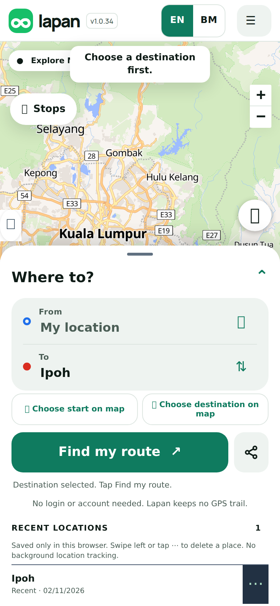
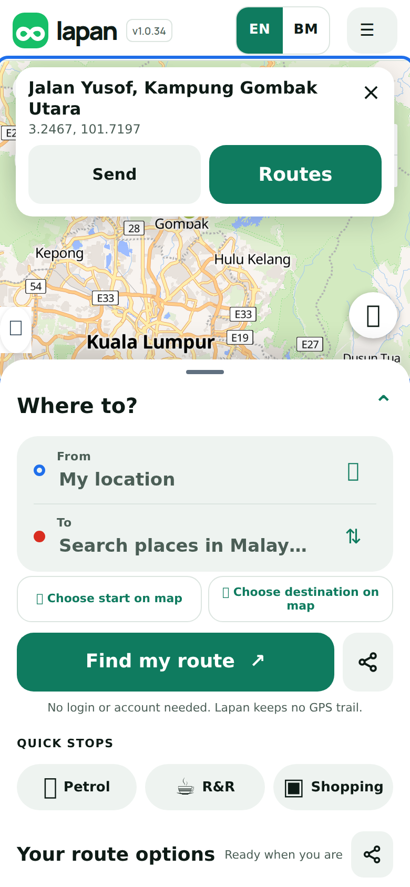
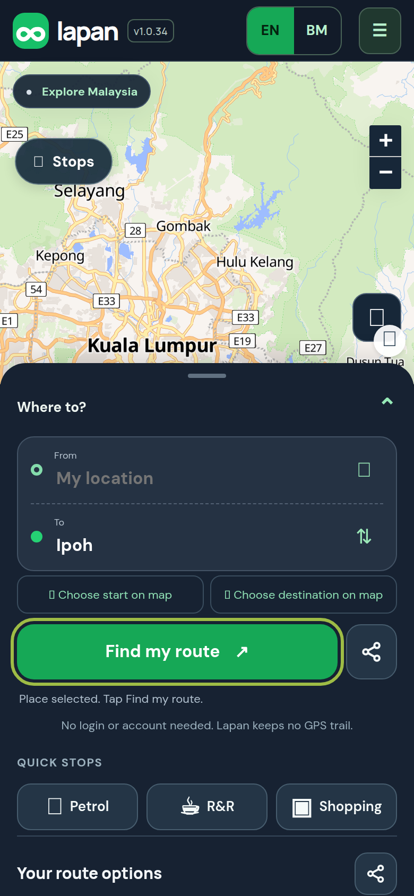
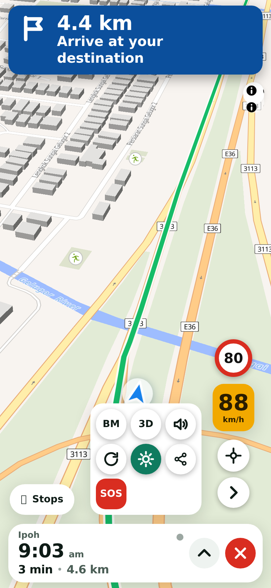
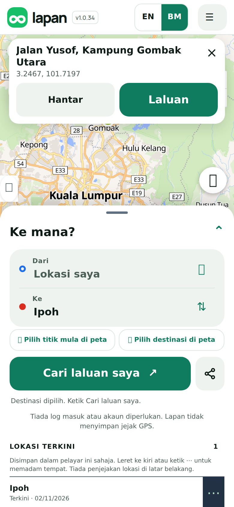

## Purpose
Waze and Google Maps spread because someone says 'meet me here' and sends a link that opens straight on that place. Lapan had no way to send a place. This adds it: one tap to make a short link, one tap for the friend to open it and get directions. It is the growth feature for people telling their friends where to go.

## Changes
- **Share this place**: a small icon beside **Find my route** (and in the route options header), so it takes no extra space. It makes a short link like `lapan.example/s/Ab3dEfG` and opens the phone's share sheet (WhatsApp, Messages and so on) with a message such as *Meet me at Ipoh. Open in Lapan: link*. If the phone has no share sheet, the message is copied, or shown to copy by hand.
- **Tap the map** for a compact card (about 140 px tall) with the place's name, **Send** and **Routes**, as in Waze. Progress shows on the card itself. The name comes from a map lookup; if that fails it shows the coordinates.
- **Share my drive** (in the driving shortcuts): *I'm on my way to Ipoh, arriving about 8:32 am. Open in Lapan: link*. It shares the arrival time you already see, **not your position**. There is no tracking.
- **A friend opens the link** and lands in Lapan with the place filled in and **Find my route** ready. If location is already allowed on their phone, routes appear straight away. Chat apps show a preview with the Lapan icon and the place name, in English and Malay.
- **Private by design**: a link stores only the place and its name for about six months (renewed while it is still used). No account, no name of the sender, no network address. The promise is in About and privacy.
- **Works without the database**: if the short-link table is missing, the link carries the place inside itself (about 80 characters) and still opens correctly.
- English and Bahasa Malaysia (*Kongsi tempat ini*, *Jumpa di Ipoh. Buka dalam Lapan*).

<p></p>

## Testing
By hand: search for a place, tap **Share this place**, and send it to another phone. Expected: the other phone opens Lapan with that place in the destination box and the button **Find my route** highlighted. Tap anywhere on the map. Expected: a card with a name, **Send** and **Routes**. Start navigation, tap the arrow beside the controls, then the share icon. Expected: a message with the arrival time and a link. Tap **BM** and repeat. Expected: the message is in Malay.

Automated:
```sh
git remote add dandycrypto https://github.com/dandycrypto/lapan-malaysia.git
git fetch dandycrypto feat/share-drive && git switch --detach FETCH_HEAD
npm run build && npm test
```
Result on commit `10960b2`: **45 of 45 test files passed**. New `share` test (real SQLite and the real migration: link creation, repeats, clashes, expiry and renewal, limits, preview tags, escaping of hostile names, links without a database, errors that show no internals) and `share-client` (link format shared by phone and server, messages in both languages, safety of the returned link, strings). I broke the code 16 ways on purpose; 2 went unnoticed at first and I added tests until all 16 failed. The tests also caught a real mistake of mine before it shipped: I had miscounted the letters used for link codes, so some codes would have contained the word *undefined*. A real-browser run with two simulated phones covered sending, opening, automatic routes, the map card, Malay, sharing a drive, links with and without the database, the copy fallback and an expired link. A layout test also checks, on 390, 360, 412 and 320 wide screens, that the icon sits beside Find my route, the card is under 150 px tall and on screen, and the toast fits.

**Not tested:** how WhatsApp, Telegram or iMessage actually draw the preview (the tags are there and correct, but each app decides), the real phone share sheet (the test replaces it), iPhone Safari, the real Cloudflare D1 (tested on SQLite, which it is built on), and a Malay speaker's check of the new strings. A link is public to anyone who has it, as with Waze; the planner says so.

## Dependencies
Needs the Driving screen restyle (and so the Language PR and UI 1) merged first. **For short links, apply `drizzle/0003_shared_places.sql` to the existing D1 database `DB`.** Until then links are longer but work. Independent of Home and Work, the traffic bar, hazard alerts and community reports.

## Impact
One new table, one small endpoint, and a page route for `/s/` and `/l/`. No accounts, no new services, no cost beyond small D1 reads and writes. The service worker is told not to keep shared pages. Rollback: remove the `share.js` script tag, leave the table.

---
Built with AI assistance (Claude Code). Part of the series; merge in order with rebase. `UNRELEASED.md` conflicts textually between PRs; keep both bullets. Nothing here bumps the version.

🤖 Generated with [Claude Code](https://claude.com/claude-code)
