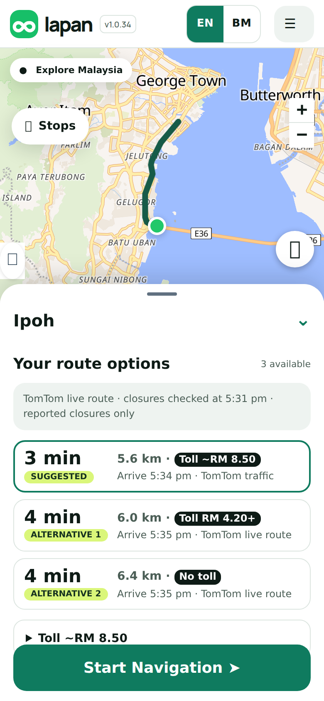
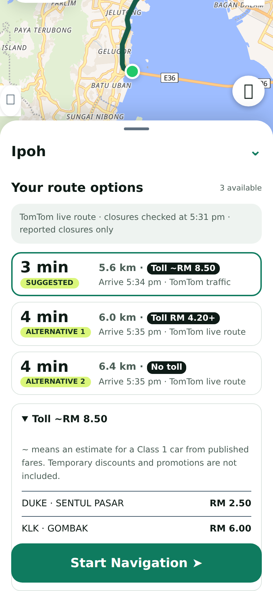
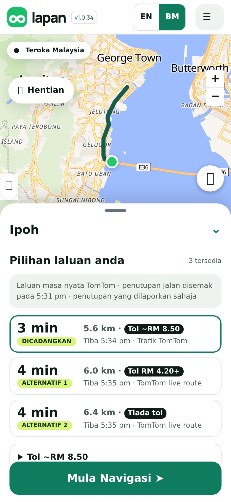
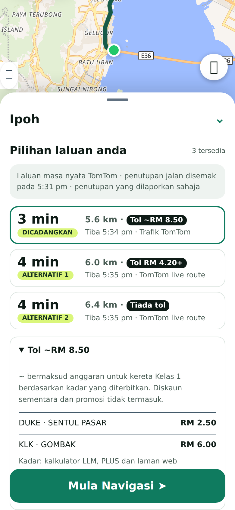

## Purpose
Waze shows what a route will cost in tolls. Lapan only priced LDP, KESAS and some PLUS trips, so most routes said *Toll estimate unavailable*. This adds published fares for 33 highways (PLUS, LPT1, WCE, ELITE, DUKE, MEX, SILK, SPRINT, the Penang bridges and more), so each route option shows a toll tag you can compare.

## Changes
- **A toll tag on every route card**: *Toll ~RM 8.50* (an estimate: every toll road on the route was priced), *Toll RM 4.20+* (at least: some tolls could not be priced, so the real total is higher) or *No toll* (TomTom reported no toll road). Never RM 0 for a route that has toll roads we could not price.
- **Details** list each highway and plaza with its fare, and say what ~ and + mean.
- **Built in, no extra server.** The fares and plaza positions (5,354 fares, 30 KB compressed) are part of Lapan, produced from the toll dataset the other agent collected. I did not make Lapan call the test server for each route: it is a test host, would add a delay and a point of failure to every route, and its own matching is looser, so it can show an exact-looking price that is too low. It stays the place the data is refreshed from (`scripts/build-toll-rates.py`).
- **Safer than a plain match.** TomTom says where the route is on toll road; only plazas on or beside those stretches are priced, so a parallel highway cannot be charged. The existing careful LDP, KESAS and PLUS pair logic runs first and is never double counted.
- English and Bahasa Malaysia (*Tol ~RM 8.50*, *Tiada tol*).

<p></p>

## Testing
By hand: plan a route that uses a toll highway, for example Kuala Lumpur to Johor Bahru. Expected: the route card shows a black tag such as *Toll ~RM 33.21*, and opening the toll details lists the highway and its fare. Plan a short route inside Kuala Lumpur on free roads. Expected: *No toll*. Tap **BM**. Expected: *Tol ~RM 33.21* and *Tiada tol*.

Automated:
```sh
git remote add dandycrypto https://github.com/dandycrypto/lapan-malaysia.git
git fetch dandycrypto feat/toll-rates && git switch --detach FETCH_HEAD
npm run build && npm test
```
Result on commit `59e4519`: **44 of 44 test files passed**. New `toll-rates` test (the 5,354 fares and 227 plazas are well formed, LDP RM 2.10 and KESAS RM 2.00 agree with the separately checked fares, closed and open pricing, 250 m tolerance, the 300 m sliver rule, no double charging, bad input, and the full Worker path) plus an updated label test. I broke the code 16 ways on purpose; the one that went unnoticed became a new test, and one edit that did nothing was a dead check I removed. On 8 real driving routes (checked outside the repo) the PLUS prices matched the dataset's own anchors: Kuala Lumpur to Johor Bahru RM 33.21, Penang RM 35.50 plus the bridge RM 5.74 = 41.24, Ipoh RM 20.34, Melaka RM 10.50. Where a toll stretch had no mapped plaza the tag says + (for example KLIA shows *RM 2.20+*, not a final-looking 2.20).

**Not tested:** real TomTom toll sections: I do not have a TomTom key here, so the 8 routes used toll roads from OpenStreetMap as a stand-in. The first real routes should be checked on the test site with a key. Also not covered: plazas the dataset has no coordinates for (49 of 227: all of SKVE and EKVE, 8 of 18 on WCE and some small urban concessions), so those routes show *RM x+*; plazas that charge in one direction only; and 14 PLUS pairs whose two directions differ in the dataset (for example Ayer Hitam to Tangkak RM 1.80 but back RM 10.09), which the data owner should check against PLUS. Class 1 cars only. Temporary discounts are not included.

## Dependencies
Needs the Language PR (and so UI 1) merged first. No server or database step. Independent of the other new features. It includes the compact route rows change (also its own PR); whichever merges first, the other becomes a no-op.

## Impact
About 84 KB of data (30 KB compressed) in the Worker, a small amount of extra work per route (a few hundred plaza checks), no new request, service, key or cost. Rollback: remove the `mergeRateTolls` call in `scripts/build.mjs`; the careful estimate runs on its own as before.

---
Built with AI assistance (Claude Code). Part of the series; merge in order with rebase. `UNRELEASED.md` conflicts textually between PRs; keep both bullets. Nothing here bumps the version.

🤖 Generated with [Claude Code](https://claude.com/claude-code)
