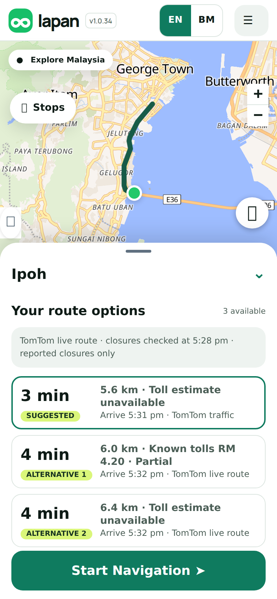
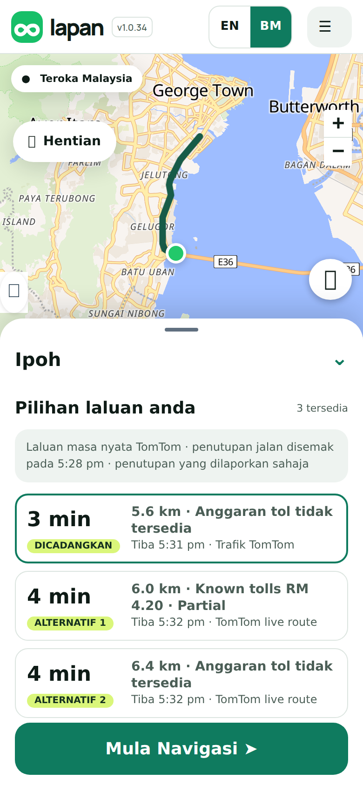
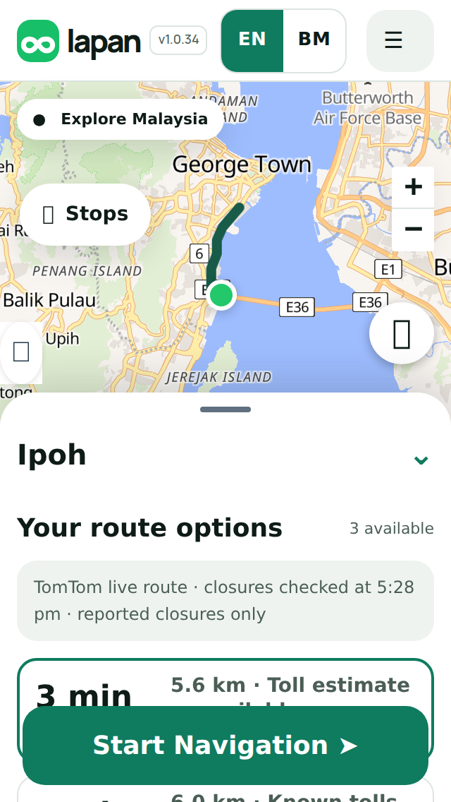

## Purpose
On a normal phone the three route options sat in three narrow columns, so *3 min*, the toll text and the arrival time all broke across several lines and the list was hard to compare. Each option is now one row, as in Waze and Google Maps.

## Changes
- **One row per route** (about 75 px): the duration and its label (*SUGGESTED*, *ALTERNATIVE 1*) on the left, the distance and toll then the arrival time on the right. All three options and **Start Navigation** fit on one screen.
- Smaller type (22 px duration, 14 px details, 12 px arrival) and no line breaks inside a row on 320, 360, 390 and 412 wide screens.
- The new look only. The classic look keeps its three columns.

<p></p>

## Testing
By hand: open the new look (`?ui=2`), plan any route. Expected: each route option is a single row; nothing wraps into several lines. Tap **BM**. Expected: the same rows in Malay.

Automated:
```sh
git remote add dandycrypto https://github.com/dandycrypto/lapan-malaysia.git
git fetch dandycrypto ui/route-rows && git switch --detach FETCH_HEAD
npm run build && npm test
```
Result on commit `99ff5f0`: **43 of 43 test files passed**. New `route-rows` test (rows stack, areas, size ceilings, every rule scoped to the new look, classic look unchanged). A real-browser run measured every route row on four phone sizes in both languages: each is 75 px tall, one line for the duration and the arrival, inside the screen, nothing cut off, no sideways scrolling.

**Not tested:** real phones (checked in a desktop browser at phone sizes) and very long place names or unusually long toll text in a row.

## Dependencies
Needs the Language PR (and so UI 1) merged first. Independent of the other new features.

## Impact
Style only: about 20 lines in the new look's stylesheet. Rollback: remove the *Route options as rows* block.

---
Built with AI assistance (Claude Code). Part of the series; merge in order with rebase. `UNRELEASED.md` conflicts textually between PRs; keep both bullets. Nothing here bumps the version.

🤖 Generated with [Claude Code](https://claude.com/claude-code)
