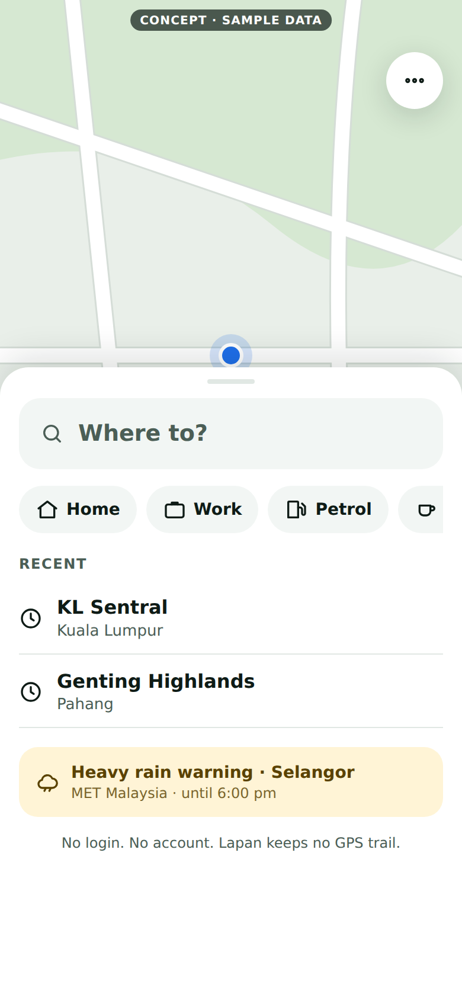
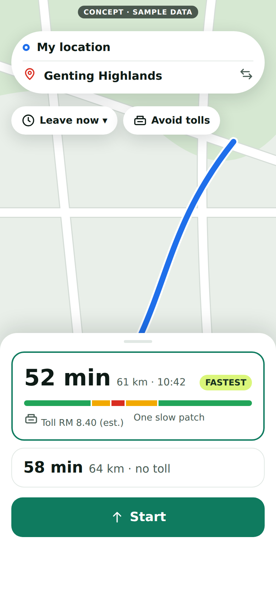
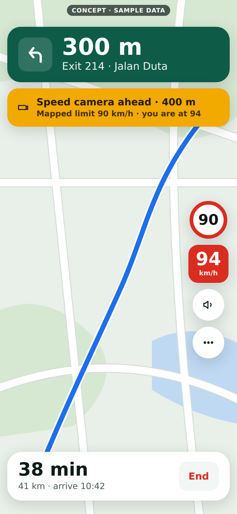
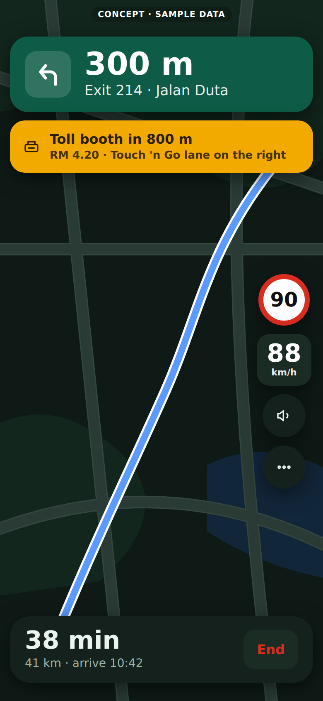

# Lapan UI revamp: plan, concept screens and live-data ideas

Written 2026-11-02. This is a plan, not built code. The pictures are **concept mock-ups with sample data**, drawn to show direction. Where something is fact I say how I know. Where it is opinion I say so.

*Left to right: Home, Route review, Driving (day, with a speed camera alert), Driving (night, with a toll booth alert). Sample data only. The toll price, the Touch 'n Go lane hint and the rain warning in the pictures need data Lapan does not have yet; they show intent, not a promise.*

## 1. What is wrong today (measured, not opinion)

| Finding | How I know |
|---|---|
| About 19 controls compete on the first phone screen. Waze's web map has 5 for the core task. | Counted from real-browser screenshots at 390 x 844, Waze Live Map vs Lapan (PR 3 shows the fix for the planner). |
| Two visual systems fight each other. A light theme lives in an inline `<style>`, and a 40 KB `mobile.css` overrides it into a dark theme. | `web/index.html` and `web/mobile.css`, line by line. |
| The driving screen shows up to 11 things at once (5 buttons, Stops, speed, limit sign, 2 banners). | Screenshots before PR 4. |
| Icons are emoji. Emoji look different on every phone, and some devices show empty boxes. | I saw boxes in headless Chrome. I have **not** checked real phones. |
| Fonts come from Google Fonts. That is a privacy leak and a render delay. | `web/index.html`. |
| The source is hand-minified: `app.js` is about 27 KB in a few very long lines. Nobody can review or change it safely. | Reading it. This is the biggest risk to everything below. |

## 2. Design principles

1. **One question per screen.** Where to? Which route? Drive.
2. **Glance, don't read.** While driving: turn distance at 38 px or more, speed at 30 px or more, one alert at a time, every touch target 48 px or more, text contrast 7:1.
3. **The map is the product.** Everything else lives in one bottom sheet with three heights (peek, half, full), the way Google Maps and Apple Maps do it.
4. **Be honest on screen.** Label data ("Mapped limit", "Data from MET Malaysia, 10 min ago"). Never show a guess as a fact. This is already how Lapan treats speed limits and cameras.
5. **Malaysian by default.** Ringgit, tolls, R&R, Touch 'n Go, exit numbers, Bahasa Malaysia, and prayer-time friendly rest stops where the data exists.
6. **Light and private.** No login, no account, no third-party scripts, no fonts from other sites. Small enough to open on a cheap phone on 4G.

## 3. Design system (so every screen looks like one product)

| Part | Proposal |
|---|---|
| Colour | Brand green `#0F7B5F`, lime accent `#DAF67A`, ink `#0E1B16`. Route is blue `#1F6FEB` with a white edge (the colour drivers already expect). Traffic uses green, amber and red along the route. Alerts are amber. A night theme switches automatically with the phone and at dusk. |
| Type | The phone's own font (no download), tabular numbers for speeds and times, a 12 / 14 / 16 / 20 / 28 / 40 scale. |
| Shape | 4 pt spacing grid, 16 px cards, 24 px sheets, 999 px chips and pills. |
| Icons | One small inline SVG set (about 25 icons, under 4 KB). Replaces emoji. |
| Motion | Sheet snaps and banner slides only, 150 to 250 ms, off when the phone asks for reduced motion. |
| Components | Sheet, Chip, Button, Card, Banner, Sign (speed limit), ListRow, Toggle. Each documented once with its states. |

## 4. How to ship it without breaking a live app

Lapan has real users, and the owner's goal is "simple, lightweight and reliable". A rewrite in one go would break that. So:

- **Strangler approach.** Build the new screens beside the old ones, behind an opt-in switch (`?ui=2`). Both run from the same data and routing code. The old UI stays the default until the new one passes the same checks.
- **Readable source for the new parts.** Plain ES modules and CSS files, no build dependencies (Lapan's build needs none today and should stay that way).
- **Every PR has screenshots and a self-test**, like the current series.
- **Budgets enforced by a test:** the new CSS stays under 20 KB and the new scripts under 60 KB (before compression), and the first screen opens with no network request to another site.
- **Visual checks:** headless Chrome at three phone sizes and both themes, compared by eye in the PR first and automatically later.

## 5. Roadmap

| Step | What | Risk |
|---|---|---|
| U0 | Design tokens, icon set, system fonts. No layout change. | Low |
| U1 | Bottom sheet and new Home screen (`?ui=2`) | Medium |
| U2 | Route review: cards, traffic bar, Leave-now, Avoid chips | Medium |
| U3 | Driving: turn banner, one alert slot with priority, speed and limit signs, ETA bar, auto night | Higher. This is the screen people depend on. |
| U4 | "Along your route" live-data cards (section 7) | Medium |
| U5 | Bahasa Malaysia, accessibility pass, motion and contrast audit | Medium |
| U6 | Make it the default, delete the old CSS and scripts | Higher. Only after a trial period. |

## 6. Where Lapan can really beat Waze and Google Maps, and where it cannot

**Can:** no login and no tracking (TuJu's biggest complaint); Malaysian toll prices and rest stops built in; honest data labels; works from a saved copy when the network or server struggles; small and fast; open-data cards for rain warnings and fuel price; Bahasa Malaysia first.

**Cannot, honestly:** Waze's crowd of live reports, and Google's worldwide place data. Lapan can narrow the gap with community reports (below) but not close it soon.

## 7. Open live data worth adding

The Worker would fetch these, cache them for a few minutes, and send phones only small summaries. The phone never calls a government server directly, and **no driver location is ever sent upstream**: the Worker fetches whole states and the phone filters.

| Data | What it adds | Source and what I verified | Notes |
|---|---|---|---|
| Weather warnings and forecasts | A banner when your route crosses a warned area ("Heavy rain · Selangor"), and "rain at destination near arrival" | MET Malaysia through the official data.gov.my API: endpoints `/weather/forecast`, `/weather/warning` and `/weather/warning/earthquake` are documented. I did not call them live. | Text is in Bahasa Malaysia only. Needs a small table from route position to state and district. |
| Weekly fuel prices | RON95, RON97 and diesel price on the Petrol shortcut | Official data.gov.my dataset `fuelprice`, licence CC BY 4.0. Field names not checked live. | Tiny and weekly. Easy first win. |
| Earthquake alerts | Rare but important banner | Same MET Malaysia API. | Low effort once the weather proxy exists. |
| Live bus and train positions | "Park and ride" or transit option | data.gov.my GTFS Realtime for KTMB, Prasarana and BAS.MY, refreshed every 30 seconds, protocol buffer format. | Heavy for a driving app. Lowest priority. |
| River levels and flood warnings | A strong monsoon-season warning | The Public InfoBanjir portal publishes levels every 15 minutes. **I found no official API.** | Needs permission from JPS before any scraping. |
| Highway CCTV and incident feeds | The thing TuJu advertises | LLM's own sources. **I found no public API.** | Ask LLM. Lapan should not scrape without permission. |
| Traffic incidents on the route | Accidents and closures beyond today's closure check | TomTom (already used). [From general knowledge, not checked today] it is a separate paid allowance. | Check cost with the owner first. |

## 8. The four features you picked, as independent builds

Each branch starts from the same tiny base (the test-runner PR) and **does not depend on any other feature**. Any one can merge alone.

| Feature | What it touches | Why it is independent |
|---|---|---|
| Traffic bar | The route result from the server, and the route card | Needs no new data source; TomTom's traffic sections are already requested. |
| Home and Work | Phone storage and a row of chips | Client only. No server, no API. |
| Hazard alerts (toll booth, curve, railway crossing, speed bump) | A bundled data file and a detector per hazard | Same pattern as speed limits. I will measure OpenStreetMap coverage first, as I did for cameras, and say plainly what is thin. |
| Community reports | A small server store plus a report button | The only one needing a backend. It needs your and Alan's agreement on privacy and cost first. Design before code. |

## 9. Decisions I need

1. Do you approve the strangler approach (`?ui=2`, old UI stays default)?
2. Is the visual direction right: green brand, blue route, amber alerts, day and night themes? Say what to change.
3. For community reports: is a small anonymous server store acceptable under Lapan's "no tracking" promise, and who pays for it? Police and roadblock reports stay out because of PDRM's request.
